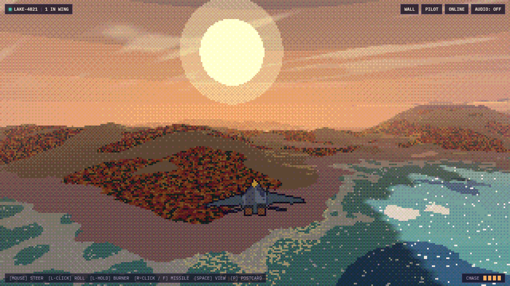
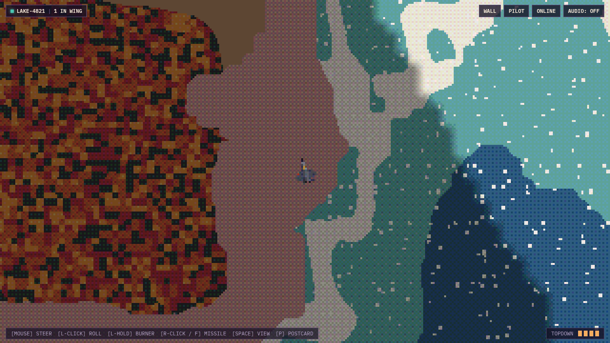
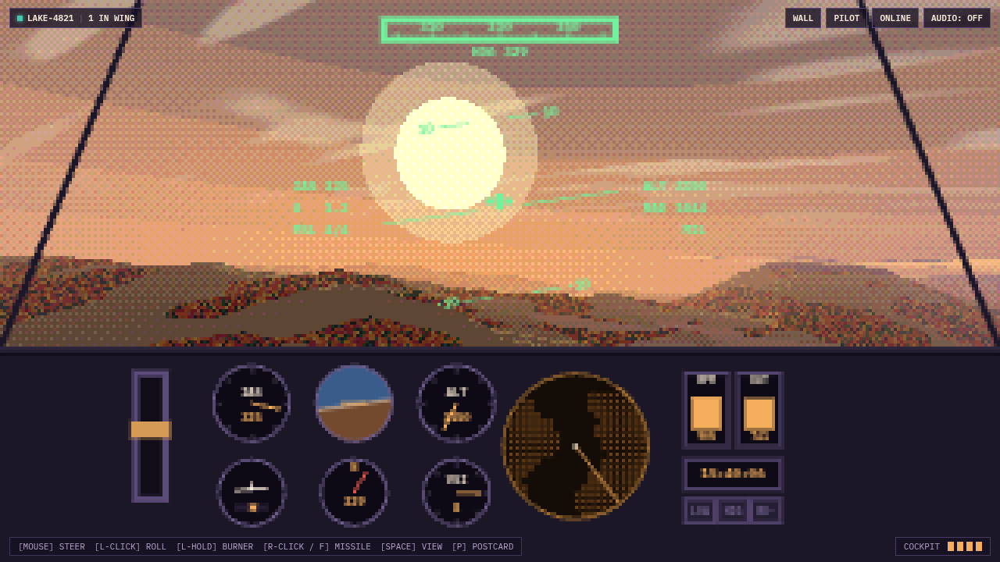
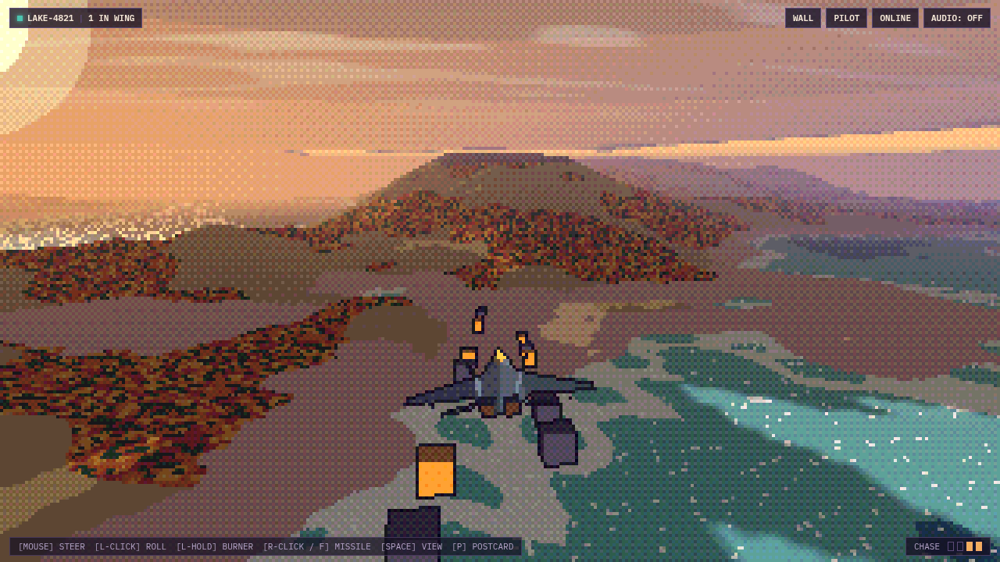
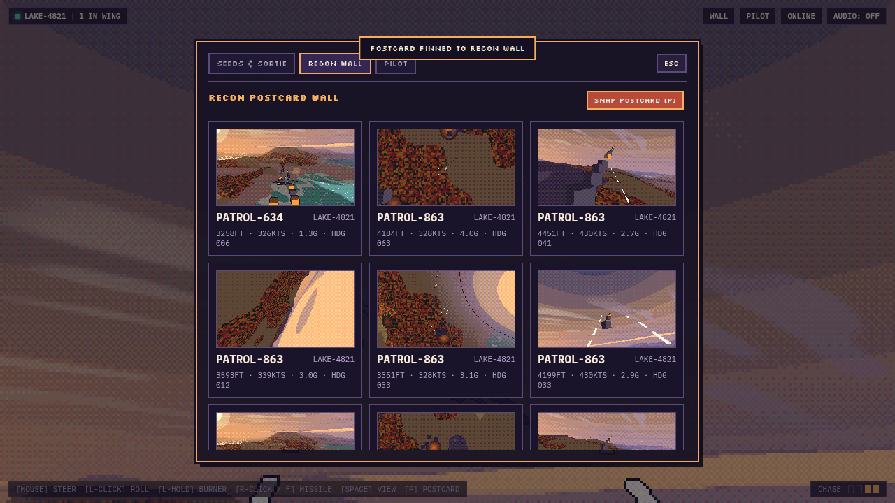

# PATROL

A retro pixel-art fighter-jet flying toy and ambient multiplayer sandbox set in autumn lake country at last light. Built with zero bloated boilerplate, 100% bespoke WebGL2/GLSL shaders, Canvas 2D pixel instrumentation, Web Workers, synthesized Web Audio, and a Fastify + WebSocket + Drizzle SQLite backend.



## Features

- **Bespoke Low-Res Pixel Renderer (WebGL2 + GLSL ES 3.00)**:
  - Renders at ~340px internal height (with dynamic resolution scaling) and upscales via nearest-neighbor filtering.
  - Curated limited palette with 4x4 Bayer ordered dithering and 1-pixel foreground silhouette outlines.
  - Ray-marched, seamlessly tiling procedural heightfield generated in a **Web Worker** with a live pixel progress bar.
  - Layered water depth bands, animated shoreline foam, crisp white glints, low-angle sky reflections, sun glitter path, autumn forest patches, terraced rock, snow caps, baked directional shadows, and real-time cumulus cloud shadows.
- **Arcade Flight & Airframe**:
  - Original twin-engine, twin-tail fighter jet with dark radome, gold bubble canopy, cropped delta wings, canted vertical fins, and customizable tail-fin accent colors.
  - Smooth autopilot S-turns until first mouse movement, automatic terrain pull-up (cannot crash), wingtip vapour trails, twin afterburner plumes, dynamic ground/cloud shadows, and low-altitude lake water spray.
  - Full touch-screen support with responsive on-screen virtual stick and action buttons.
- **Three Cameras & Live Pixel Cockpit**:
  - Cycle **Top-Down**, **Chase**, and **Cockpit** views with `Space` (~1s smooth blend).
  - Hand-plotted Canvas 2D instrument panel: IAS, artificial horizon, altimeter, turn-and-slip, compass, VSI, amber ground-mapping radar with rotating sweep, dual RPM/EGT gauges, real local clock, warning lamps, and animated throttle lever, paired with a collimated pixel HUD.
- **Missiles & Impact FX**:
  - 4 wing-mounted missiles that physically detach from rails and re-arm over time.
  - Pixelated flame/smoke trails, flash/fireball/shock-ring/smoke-column impacts on land with glowing ember scorch marks, and tall white spray columns with expanding foam rings on water.
- **Full-Stack Ambient Multiplayer & Sandbox**:
  - **Patrol Wing (WebSockets)**: Fly alongside other pilots on the same world seed in real time, complete with synchronized attitude, afterburners, missiles, and radar contacts, plus a Solo/Offline toggle.
  - **Seeds & Weather Presets (`GET/POST /api/seeds`)**: Shareable permalinks (`/s/:seedCode`), community seed saving/upvoting, and *Last Light*, *Crimson Dusk*, and *High Alpine* presets.
  - **Recon Postcard Wall (`GET/POST /api/postcards`)**: Press `P` to capture a native-resolution pixel PNG with live flight telemetry.
  - **Optional Recon Sortie Mode (`GET/POST /api/sorties`)**: Deterministic ring courses per seed with a minimalist leaderboard.
  - **Synthesized Web Audio**: Procedural turbine hum, afterburner roar, wind rush, missile whoosh, and detonations (muted/off by default).

## Screenshots

| Top-Down Tactical View | Cockpit & Collimated HUD |
| :---: | :---: |
|  |  |

| Active Missile Strike | Recon Postcard Wall |
| :---: | :---: |
|  |  |

## Controls

| Input | Action |
| :--- | :--- |
| **Mouse** | Steer smoothly (top-down: bank toward cursor; chase/cockpit: roll & pitch) |
| **Left Click** | Barrel roll |
| **Left Hold** | Engage afterburners |
| **Right Click** or **`F`** | Fire missile |
| **`Space`** | Cycle camera view (Top-Down / Chase / Cockpit) |
| **`P`** | Snap & pin pixel postcard to Recon Wall |

## Quick Start

```bash
# Install dependencies
npm install

# Start both client (Vite :5173) and server (Fastify :3001) concurrently
npm run dev
```

Open `http://localhost:5173` in your browser.

## Scripts & Verification

```bash
npm run typecheck   # Type-check shared, server, and client
npm run build       # Build all workspaces for production
npm start           # Run production server (serves client/dist + API + WebSockets)
npm test            # Run unit & API/SQLite integration tests
npm run test:e2e    # Run Playwright visual & automated soak test suite
```

## Repository Structure

```text
├── shared/     # Deterministic PRNG, periodic terrain sampler, shared types & WS protocol
├── client/     # Vite + TypeScript + WebGL2/GLSL shaders + Canvas 2D HUD + Web Audio + Worker
├── server/     # Fastify + ws + Drizzle ORM + SQLite persistence
├── tests/      # Playwright end-to-end visual & soak verification
└── Dockerfile  # Production container image
```